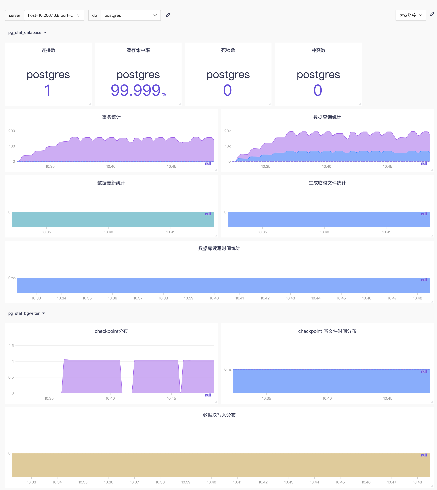

# postgresql

postgresql 监控采集插件

## authorization

```shell
create user categraf with password 'categraf';
 
alter user categraf set default_transaction_read_only=on;

grant usage on schema public to categraf;

grant select on all tables in schema public to categraf ;
```

## configuration

```toml
[[instances]]
address = ""
# labels = { region="", zone="" }
## postgresql 的连接信息
# address = "host=1.2.3.4 port=5432 user=postgres password=123456 sslmode=disable"

## outputaddress 相当于是addres的别名 
# outputaddress = "db01" 

## 一条连接保持活跃的最大时长， 0s表示永远
## 当查询执行时，到达最大时长的连接不会被立即强制断开
# max_lifetime = "0s"

## 忽略哪些db的采集
# ignored_databases = ["postgres", "template0", "template1"]

## 显式指定采集哪些db 
# databases = ["app_production", "testing"]

## Whether to collect statement-level metrics.
## Requires extension pg_stat_statements enabled, see https://www.postgresql.org/docs/current/pgstatstatements.html
# enable_statement_metrics = false

## Max number of statements to collect
## applies only when enable_statement_metrics=true
## 0 means no limit
# statement_metrics_limit = 100

## 历史字段，不能用它选择连接协议；请在 address 中配置查询模式。
# prepared_statements = true

## Whether to skip built-in metrics from pg_stat_database.
# disable_pg_stat_database = false

## Whether to skip built-in metrics from pg_stat_bgwriter.
## On PostgreSQL 17+, this also skips compatibility metrics collected from pg_stat_checkpointer.
# disable_pg_stat_bgwriter = false
```

### PostgreSQL 驱动与 PgBouncer

插件使用 `pgx/v5`。连接 PgBouncer（例如 transaction pooling）时，可以通过真实的
`address` 配置选择 simple protocol：

```toml
[[instances]]
address = "host=localhost port=6432 user=categraf dbname=postgres sslmode=disable default_query_exec_mode=simple_protocol"
```

URI 形式同样支持：

```toml
[[instances]]
address = "postgres://categraf@localhost:6432/postgres?sslmode=disable&default_query_exec_mode=simple_protocol"
```

原有连接串参数 `prefer_simple_protocol=true/false` 继续有效，布尔值沿用 pgx v4 的
解析规则。不要与 `default_query_exec_mode` 同时配置，否则初始化将报错。
原有 `statement_cache_mode=prepare/describe` 也继续有效；`describe` 使用描述缓存，
不创建命名的预备语句。它同样不能与 `default_query_exec_mode` 同时配置。
`statement_cache_capacity=0` 在未显式选择原生 v5 模式时使用无缓存的 Describe/Exec。
这些旧客户端参数在建立连接前会被消费，不会发送给 PostgreSQL。

没有配置查询模式时使用 pgx v5 默认值。`IsPgBouncer` 不是 TOML 配置入口，
`prepared_statements=false` 也不能替代上述连接串配置。`statement_cache_capacity`、
`description_cache_capacity` 等原生参数可按 pgx v5 的规则配置。

### 驱动迁移回归测试

配置入口、旧参数兼容和畸形 PostgreSQL DataRow 测试无需数据库：

```sh
go test -race ./inputs/postgresql
```

真实连接测试使用以下环境变量指定**可销毁的测试数据库**，未设置的端点会跳过。
测试会创建事务内临时表验证 dollar-quoted SQL 的绑定参数处理，事务结束后自动删除。

| 环境变量 | 测试端点 |
| --- | --- |
| `CATEGRAF_POSTGRES_TEST_DSN` | PostgreSQL 直连，建议键值格式 |
| `CATEGRAF_POSTGRES18_TEST_DSN` | PostgreSQL 18，建议 URI 格式 |
| `CATEGRAF_PGBOUNCER_TEST_DSN` | PgBouncer transaction pooling |
| `CATEGRAF_POSTGRES_TLS_TEST_DSN` | 带 `sslmode=verify-full` 和 `sslrootcert` 的 TLS 连接 |
| `CATEGRAF_POSTGRES_SOCKET_TEST_DSN` | Unix socket；可使用 `.s.PGSQL.5432` 文件路径 |

这些 DSN 不应预先包含协议/缓存模式参数，测试会分别添加默认、旧 simple、新 simple、
旧描述缓存和禁用缓存配置，经过 TOML 加载、`Init`、注册驱动建立连接。
PgBouncer 测试已覆盖 `pool_mode=transaction`、`max_prepared_statements=0` 的配置。
测试还验证默认指标、自定义 SQL 的数值/标签、SQL 类型扫描、错误返回和超时。

```sh
# 先将相应环境变量设置为测试环境的连接串，再运行：
go test -v -count=1 -run TestPostgreSQLIntegration ./inputs/postgresql
```



## metrics

The following metrics are emitted when `enable_statement_metrics = true` (requires `pg_stat_statements`). All are cumulative counters (may reset on PostgreSQL restart or when stats are reset).

| Metric | Labels | Type |
| --- | --- | --- |
| `postgresql_statements_calls_total` | `server`, `db`, `user`, `datname`, `query` | counter |
| `postgresql_statements_exec_milliseconds_total` | `server`, `db`, `user`, `datname`, `query`  | counter (milliseconds) |
| `postgresql_statements_rows_total` | `server`, `db`, `user`, `datname`, `query`  | counter (rows) |
| `postgresql_statements_block_read_milliseconds_total` | `server`, `db`, `user`, `datname`, `query` | counter (milliseconds) |
| `postgresql_statements_block_write_milliseconds_total` | `server`, `db`, `user`, `datname`, `query`  | counter (milliseconds) |

Notes:
- `query` is normalized by replacing newlines/tabs with spaces.
- For PostgreSQL ≥ 13, the exporter adapts to renamed columns; metric names above remain unchanged.
- For PostgreSQL ≥ 17, `pg_stat_bgwriter` was split into `pg_stat_bgwriter` and `pg_stat_checkpointer`. The plugin automatically queries the new view and maps the columns to the old metric names to preserve backward compatibility.
    - `pg_stat_checkpointer.num_timed` -> `checkpoints_timed`
    - `pg_stat_checkpointer.num_requested` -> `checkpoints_req`
    - `pg_stat_checkpointer.write_time` -> `checkpoint_write_time`
    - `pg_stat_checkpointer.sync_time` -> `checkpoint_sync_time`
    - `pg_stat_checkpointer.buffers_written` -> `buffers_checkpoint`
